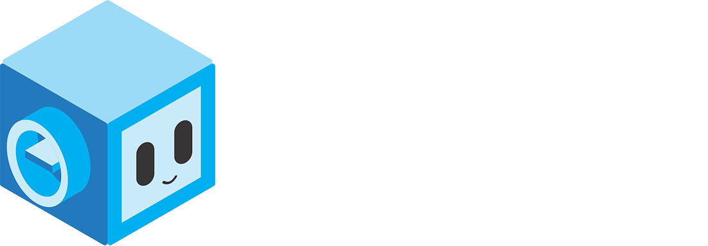

## What is Numo?

Numo is a futures exchange for stablecoin FX pairs.

<Columns cols={2}>
  <Card title="Fully onchain exchange" icon="arrow-right-arrow-left" href="/spot">
    Execute and settle on Base, composable with spot and lending protocols.
  </Card>

  <Card title="Futures" icon="chart-line" href="/futures">
    Trade the carry and basis with futures across multiple FX stablecoin pairs.
  </Card>
</Columns>

## Accessing Numo

Numo is available at [app.numofx.com](https://app.numofx.com).

## Connect a wallet and fund your account

Before you begin, make sure you have USDC or cNGN on Base. Numo accepts both as
[collateral](/collateral).

<Steps>
  <Step title="Choose how to sign in">
    Select **Connect Wallet** at [app.numofx.com](https://app.numofx.com).

    <Columns cols={2}>
      <Card title="Option A: Email" icon="user">
        **Recommended for first-time users**

        Enter your email. Numo creates a wallet for you through Privy, so you do not need to
        install a wallet extension.
      </Card>

      <Card title="Option B: Browser wallet" icon="wallet">
        **For users with a wallet on Base**

        Connect a browser wallet such as MetaMask or Coinbase Wallet, on the Base network.
      </Card>
    </Columns>
  </Step>

  <Step title="Deposit">
    Select **Deposit**, choose USDC, EURC, or cNGN, and enter an amount. The minimum is 10 USDC or equivalent in other currencies.

    Your first deposit opens your [subaccount](/subaccounts). Numo pays the gas.
  </Step>

  <Step title="Trade">
    Pick [spot](/spot) or [futures](/futures) and place an order.
  </Step>
</Steps>
